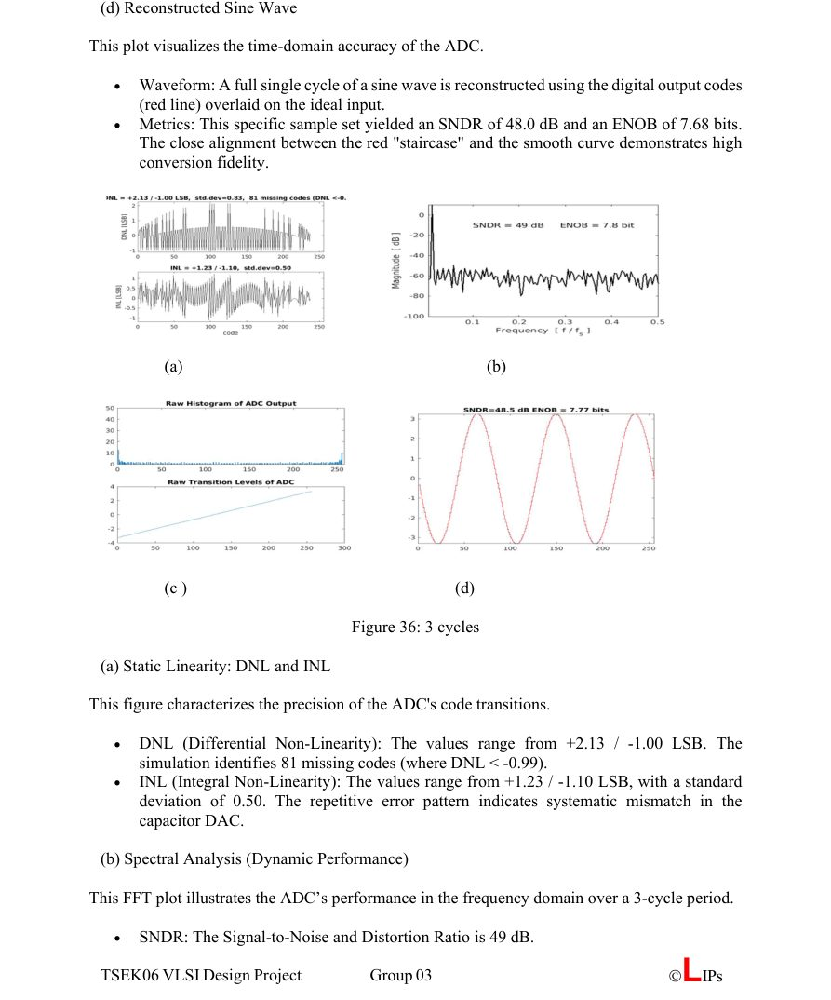
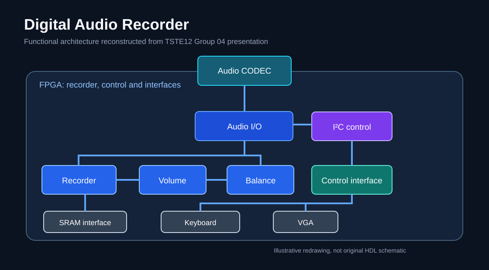

# Md. Tafshirul Alam

**MSc Electronics Engineering | VLSI & Digital IC Design | Embedded Systems**

📍 Linköping, Sweden · 🎓 Linköping University

I am an Electronics Engineering master's student at Linköping University with a background in electrical engineering and professional experience in power systems. My technical interests include **digital integrated circuits, VLSI, system-on-chip design, and embedded hardware**.

## Featured project

### [8-bit Fully Differential SAR ADC](projects/8-bit-sar-adc/README.md)
**TSEK06 VLSI Design Project · Group 03 · Linköping University · 2026**

An academic mixed-signal team project involving behavioral models, transistor-level implementation, physical layout, and simulation of an 8-bit fully differential successive-approximation ADC.

**My work:** SAR control-logic modeling, testbench development, DFFSR schematic/layout work, and verification and integration.

| Specification | Reported result |
| --- | --- |
| Resolution and supply | 8 bits; 3.3 V |
| Transistor-level power | 356.8 µW (nominal simulation) |
| Integrated-chip power | ~539 µW (1-cycle simulation) |
| SAR controller | 19 DFFSR elements |
| Design tools | Cadence Virtuoso, Spectre, Verilog-A, MATLAB |

*Selected spectrum from the TSEK06 Group 03 SAR ADC simulation report.*

**[Explore the SAR ADC case study and full figure gallery →](projects/8-bit-sar-adc/README.md)**

## University digital design project

### [Digital Audio Recorder with VHDL and I²C](projects/digital-audio-recorder-vhdl-i2c/README.md)

**TSTE12 · Linköping University · Completed team project**

Contributed to a VHDL-based digital audio recorder with a focus on **I²C peripheral communication and control**. Implemented the interface, debugged protocol timing, and supported integration with the overall recording system.

*System architecture reconstructed from the TSTE12 presentation screenshots.*

**Key areas:** VHDL · I²C · Digital design · Embedded systems · Interface debugging

[Read the project details →](projects/digital-audio-recorder-vhdl-i2c/README.md)

## Independent engineering portfolio projects

The following are **independently created portfolio demonstrations**, with source code, documented assumptions, and tests. They are not presented as completed university courses, commercial products, or previous employer deliverables.

| Project | Technologies | What it demonstrates |
| --- | --- | --- |
| [SAR ADC behavioral model](projects/sar-adc-behavioral-model/README.md) | Python, unittest | MSB-first SAR decision algorithm, numerical reference modeling, test cases |
| [UART transmitter RTL](projects/uart-transmitter-rtl/README.md) | Verilog, Icarus Verilog | Clocked finite-state machine, serial 8-N-1 transmission, self-checking testbench |
| [Three-phase power calculator](projects/three-phase-power-calculator/README.md) | Python, unittest | Balanced three-phase AC power calculations, validation, unit tests |

**Try the code:** Each project README includes the prerequisites and local run/test commands. Hardware RTL has not been validated on a physical FPGA or ASIC.

## Other projects and research

| Project | Technologies and focus |
| --- | --- |
| Mealy state machine (TSTE12) | VHDL, sequential logic, finite-state-machine design |
| Divider model (TDTS07) | SystemC/C++, hardware modeling |
| Multijunction photovoltaic-cell research | SCAPS-1D simulation and photovoltaic-device modeling |

*The additional coursework source files have not yet been published.*

## Technical skills

- **IC and digital hardware:** Cadence Virtuoso, Spectre, Verilog-A, VHDL, SystemC, DRC/LVS
- **Programming and analysis:** C/C++, Python, MATLAB
- **Electrical systems:** transformers, substations, commissioning, preventive maintenance, load calculations
- **Other tools:** SCAPS-1D, AutoCAD Electrical, PLC programming

## Experience

**Electrical Engineer | Bridgex Concrete Limited, Bangladesh | From March 2021**

Experience in industrial power distribution, transformer and substation operation, maintenance, troubleshooting, and electrical installations.

## Education

- **Master's Programme, Electronics Engineering**, Linköping University, Sweden (ongoing)
- **BSc, Electrical and Electronic Engineering**, Southeast University, Bangladesh

## Publication

**“Performance Maximization of Hydrogenated Amorphous Silicon Multijunction PV Cell Incorporating GaAs Junction.”** First-author publication, *SEUJEEE*, Vol. 1, Issue 2, July 2021. Modeling with SCAPS-1D.

---

**Currently focused on:** Digital IC design · VLSI design and verification · SoC design · Embedded systems

[Project portfolio](projects/8-bit-sar-adc/README.md) · [SAR ADC implementation notes](projects/8-bit-sar-adc/docs/implementation-notes.md)
