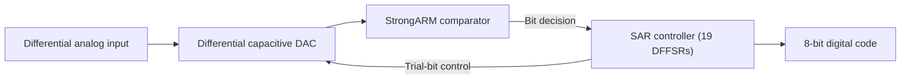

# 8-bit Fully Differential SAR ADC

**TSEK06 VLSI Design Project · Group 03 · Linköping University · Spring 2026**

An academic mixed-signal IC design project implementing an 8-bit fully differential successive approximation register (SAR) analog-to-digital converter. The team developed behavioural models, transistor-level circuits, physical layouts, and chip-level simulations.

## Functional architecture

*High-level functional diagram reconstructed from the group report; not the original Cadence schematic.*

## Figure gallery index

The original report contains circuit diagrams and simulation results, including the following selected **PDF pages**. Captions identify the source and design stage. Figure images have been extracted into a separate companion package and are **not yet hosted in this repository**.

| PDF page | Figure content |
| --- | --- |
| 18 | SAR / DAC test results |
| 28 | Comparator simulation |
| 33 | SAR control logic waveforms |
| 35 | Binary-weighted CDAC schematic |
| 40 | Cycle-based ADC analysis |
| 64 | Post-layout performance analysis |
| 65 | Post-layout reconstructed signal / spectrum |
| 67 | Multi-cycle performance results |

Only selected pages and their labels are referenced here. All performance numbers are simulations, not fabricated-silicon measurements. This is collaborative group work and publication of original figures should respect group and university permissions.

## My contribution

**Md. Tafshirul Alam**

- Transistor-level modelling of the SAR control logic.
- SAR testbench development and simulation debugging, working with Kun Lin.
- Behavioural modelling and SAR logic coding.
- D flip-flop with set/reset (DFFSR) schematic and layout design.
- SAR logic integration and layout verification using DRC/LVS.
- Technical documentation and presentation preparation.

These activities are recorded in the individual work log on PDF page 83 of the group report. The complete ADC and its performance results are team achievements.

## Architecture

| Block | Function and implementation |
| --- | --- |
| Sampling and capacitive DAC | Fully differential, binary-weighted capacitor arrays with bottom-plate sampling and charge redistribution |
| Comparator | Dynamic StrongARM latch for resolving the differential input |
| SAR control logic | 19 DFFSR elements, organised into sequencing and code-storage logic |
| Output control | Eight bit decisions from MSB to LSB, followed by an end-of-conversion indication |

During sampling, the capacitor arrays acquire the input. During conversion, the SAR controller tests one bit at a time, uses the comparator decision to retain or clear that bit, and updates the DAC for the next comparison.

## Design parameters

| Parameter | Reported value |
| --- | --- |
| Resolution | 8 bits |
| Supply/reference voltage | 3.3 V |
| Sampling rate | 2 MS/s |
| Master clock | 18 MHz |
| Timing | Nine master-clock periods per sample, including eight bit decisions |
| CDAC unit capacitance | 20 fF |
| MSB capacitance | 2.56 pF |
| Binary-weighted array capacitance | 5.12 pF |

## Tools and workflow

**Cadence Virtuoso · Spectre · Verilog-A · MATLAB · DRC/LVS**

The workflow progressed from behavioural modelling and block-level testbenches to transistor-level implementation, physical layout, and system integration. The report documents transient simulations, FFT-based dynamic analysis, histogram-based linearity analysis, and process-corner evaluation.

## Selected simulation results

The values below come from different design stages and test conditions. They are reported simulation results, not measurements from fabricated silicon.

| Design stage and condition | Result | Source in group report |
| --- | --- | --- |
| Transistor-level, nominal typical | 356.8 µW power | PDF page 48 |
| Layout-stage, 1-cycle reconstruction | 48.0 dB SNDR; 7.68-bit ENOB | PDF pages 64–65 |
| Layout-stage, 5-cycle reconstruction | 49.2 dB SNDR; 7.88-bit ENOB | PDF page 67 |
| Fully integrated chip, 1-cycle simulation | Approximately 539 µW power | PDF page 81 |
| Fully integrated chip, nominal | ENOB: 7.56 bits at 1 cycle; 7.71 bits at 3 and 5 cycles; 7.42 bits at 115 cycles | PDF page 81 |

Chip-level integration included the padframe, decoupling cells, clock buffer, and top-level routing. The report also evaluates fast-fast and slow-slow process corners.

### Evaluation limitations

The report's histogram analysis identifies missing codes and DNL/INL errors in several test cases. These results require further investigation of static linearity and code coverage; the dynamic ENOB figures alone do not demonstrate an error-free 8-bit transfer characteristic. Summary sections sometimes round performance values, so the table above preserves the stated stage and test condition.

## Team

Melih Topchuoglu, Shukla Chakraboty, Mingyang Li, Chunze Zhao, Kun Lin, Mingrui Zhang, and Md. Tafshirul Alam.

**Course responsible:** Alireza Saberkari  
**Supervisor:** Wei Cao

## Documentation scope

This folder contains a portfolio summary based on the 83-page group report, *8-bit Differential SAR ADC Design*, supplied as `TSEK06_final_report_group03(2).pdf`. It does not currently contain the PDF, original Cadence design database, PDK files, simulation datasets, or executable source files.

[Back to profile](../../README.md)
